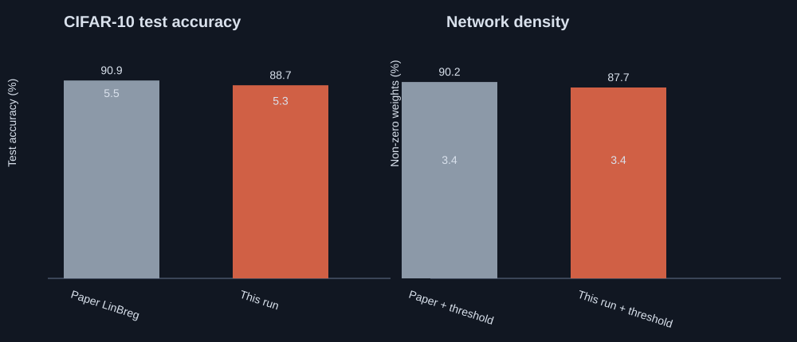
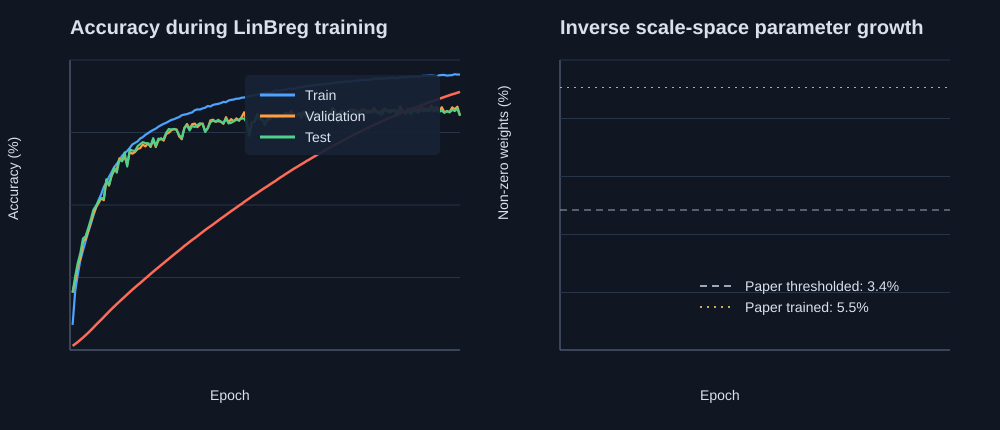

# Sparse ResNet-18 Training with Linearized Bregman Iterations

A reproducible PyTorch implementation of sparse ResNet-18 training on CIFAR-10
using linearized Bregman iterations (LinBreg). The project follows
[A Bregman Learning Framework for Sparse Neural Networks](https://arxiv.org/abs/2105.04319)
by Bungert et al.

The final model uses **3.40% of ResNet-18's convolutional and linear weights**
and reaches **87.68% test accuracy** on CIFAR-10. The paper reports 90.2% at the
same density. This repository documents the implementation, the measured gap,
and the experiments used to investigate it.



## Results

| Metric | Paper | This reproduction |
|---|---:|---:|
| Test accuracy after LinBreg | 90.9% | 88.72% |
| Non-zero weights after LinBreg | 5.5% | 5.26% |
| Test accuracy after thresholding | 90.2% | **87.68%** |
| Final non-zero weights | 3.4% | **3.40%** |

The unthresholded run follows the paper's inverse scale-space behavior:
weights start at roughly 1% density and grow as optimization progresses. At
150 epochs, magnitude thresholding reduces the network from 5.26% to 3.4%
density. That step lowers test accuracy by about one percentage point.



## Method

The optimizer keeps a subgradient variable `v` and reconstructs the model
weights `theta` through the proximal operator:

```text
v <- v - learning_rate * gradient
theta <- sign(v) * max(abs(v) - lambda, 0)
```

Implementation details:

- CIFAR-10 ResNet-18 with 3x3 stem and no convolution bias.
- Bernoulli sparse initialization with 1% density.
- Variance correction so the masked initialization preserves He scaling.
- `lambda = 0.1`, `delta = 1`, initial learning rate `0.1`.
- Random crop and horizontal flip during training.
- Dense bias and batch-normalization parameters.
- Global magnitude thresholding to 3.4% density after training.
- Mixed-precision CUDA training with resumable checkpoints.

## Why the result differs

The paper reports 90.2% at 3.4% density. This run reaches 87.68%, a gap of 2.52
percentage points.

The main observed issue was learning-rate timing. An early validation-based
plateau schedule reduced the learning rate too aggressively while support was
still growing. A constant learning-rate run reached the paper's density range,
but direct thresholding still cost accuracy. Fine-tuning only the retained
3.4% support did not improve the result, so it was excluded from the final
reported score.

These deviations are recorded in the submitted artifact instead of being
hidden. The project should be read as a partial reproduction with an
investigation of the gap, not as an exact match to the paper.

## Repository layout

```text
src/train.py             Training, evaluation, thresholding, and plots
verify.py                Output contract and artifact checks
results/results.json     Final challenge result
results/metrics.json     Detailed run metrics
results/history.csv      Per-epoch training history
assets/                  Reproduced figures
```

## Run locally

Python 3.11 and an NVIDIA GPU are recommended. The implementation was tested
with PyTorch 2.11 and CUDA 12.8.

```bash
python -m pip install -r requirements.txt
python src/train.py \
  --epochs 150 \
  --scheduler-factor 1.0 \
  --output-dir outputs
python verify.py
```

The loader reads `work/data/train.parquet` and `work/data/test.parquet` when
available. Otherwise it falls back to `torchvision.datasets.CIFAR10`.

## What this project demonstrates

- Translating a paper algorithm into a working PyTorch training loop.
- Debugging sparse optimizer and learning-rate interactions on a GPU.
- Comparing reproduced numerical results with values from the original paper.
- Packaging outputs, execution metrics, figures, and a typed experiment trace
  for a reproducible research submission.

## Next steps

- Repeat the experiment across multiple random seeds and report mean and
  standard deviation.
- Measure actual inference latency, activation sparsity, and memory use rather
  than relying only on the fraction of non-zero weights.
- Compare LinBreg with magnitude pruning and structured pruning at matched
  density.
- Investigate support selection during thresholding and sparse recovery
  training.

## Citation

```bibtex
@article{bungert2022bregman,
  title   = {A Bregman Learning Framework for Sparse Neural Networks},
  author  = {Bungert, Leon and Roith, Tim and Tenbrinck, Daniel and Burger, Martin},
  journal = {Journal of Machine Learning Research},
  volume  = {23},
  number  = {192},
  pages   = {1--43},
  year    = {2022}
}
```
