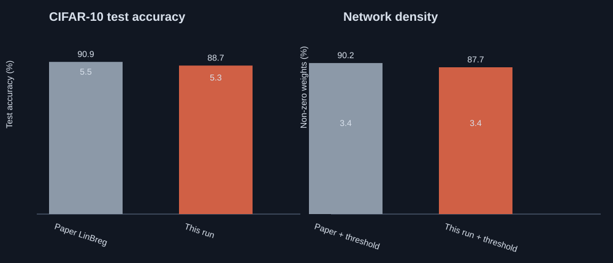

# 基于线性化 Bregman 迭代的稀疏 ResNet-18

这个仓库复现了 Bungert 等人在 *A Bregman Learning Framework for Sparse
Neural Networks* 中提出的 LinBreg 训练方法，并在 CIFAR-10 上训练 ResNet-18。

最终模型保留了 ResNet-18 全部卷积层和线性层权重的 **3.40%**，测试准确率为
**87.68%**。论文在相同非零比例下报告 90.2%，本次复现低 2.52 个百分点。

| 指标 | 论文 | 本次复现 |
|---|---:|---:|
| LinBreg 训练后准确率 | 90.9% | 88.72% |
| LinBreg 训练后非零权重 | 5.5% | 5.26% |
| 阈值化后准确率 | 90.2% | **87.68%** |
| 最终非零权重 | 3.4% | **3.40%** |



## 实现内容

- CIFAR-10 ResNet-18，使用 3x3 stem 和无偏置卷积。
- 1% Bernoulli 稀疏初始化，并修正 He 方差。
- LinBreg 的 `v` 更新和软阈值权重重建。
- `lambda=0.1`、`delta=1`、初始学习率 `0.1`。
- 随机裁剪、水平翻转、BF16 混合精度和断点续训。
- 训练结束后做全局幅值阈值化，将密度降到 3.4%。
- 自动生成训练曲线、论文对比图、逐轮指标和结果校验。

## 偏差原因

第一次训练中，验证准确率的小幅波动触发了学习率减半，网络过早停止增加非零
权重，100 个 epoch 时密度只有约 4.1%。改为恒定学习率并续训到 150 个 epoch
后，未阈值化网络达到 5.26% 密度和 88.72% 准确率。

直接阈值到 3.4% 后，准确率降到 87.68%。冻结保留权重并继续微调也没有带来
提升，因此没有把微调结果写入最终成绩。仓库明确记录这一偏差，不把结果描述为
完全复现。

## 运行

```bash
python -m pip install -r requirements.txt
python src/train.py \
  --epochs 150 \
  --scheduler-factor 1.0 \
  --output-dir outputs
python verify.py
```

默认读取 `work/data/train.parquet` 和 `work/data/test.parquet`；文件不存在时
回退到 `torchvision.datasets.CIFAR10`。

## 后续工作

- 使用多个随机种子报告均值和标准差。
- 测量真实推理延迟、显存和 FLOPs，而不只统计非零权重。
- 与 magnitude pruning、structured pruning 做同密度对比。
- 研究阈值化阶段的支撑集选择和稀疏恢复训练。
